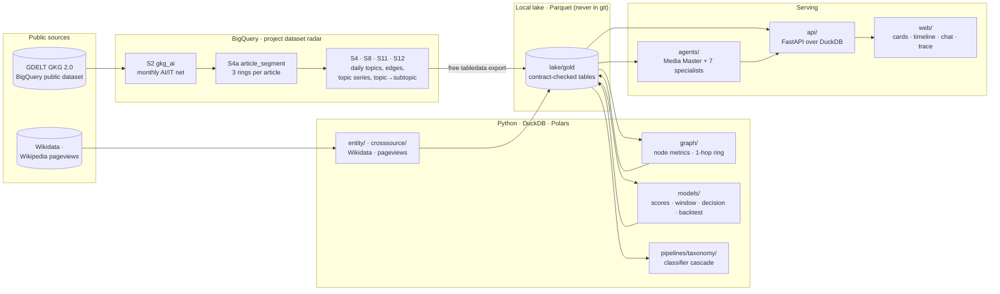
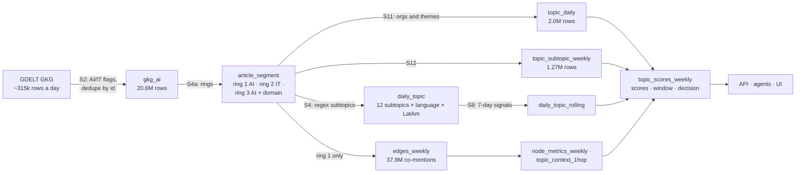
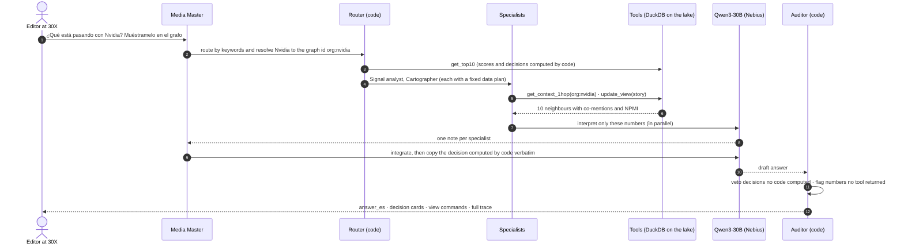
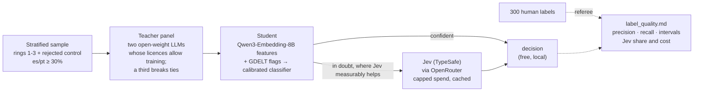
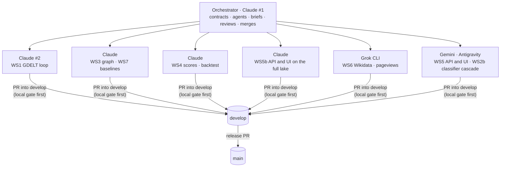

<div align="center">

# Radar de Señal Temprana

### The early-signal radar of AI topics for 30X

**We tell you which AI topics are about to land on LinkedIn, why, and from which emotional angle to tell them to
LatAm executives.**

[](https://github.com/LEONOB2014/Blinky/actions/workflows/ci.yml)
[](CHANGELOG.md)
[](LICENSE)
[](https://www.conventionalcommits.org/en/v1.0.0/)
[](.pre-commit-config.yaml)
[](https://github.com/astral-sh/ruff)
[](https://docs.astral.sh/uv/)
[](https://www.python.org/)
[](bq_sql/)

<sub>Reto 30X "Radar de contenido" · built by Andrés Becerra</sub>

</div>

---

## What it does

LinkedIn bans automated collection, so the radar watches the open chain upstream of it: global news (GDELT, 65
languages, with tone and emotions) and reference attention (Wikipedia es/pt/en). LinkedIn itself is observed only
through 30X's own analytics.

Every week it ranks the AI topics that are rising, with six scores, a lifecycle stage, a window chip ("how many days
before this lands in Spanish"), a decision (`publicar_ahora`, `preparar`, `esperar`, `no_es_tema_caliente`) and the
reasons. A team of agents, led by a **Media Master**, answers questions about it in Spanish, drives the views and
explains every decision with numbers a tool returned. A code Auditor flags any number no tool returned.

The full plan is in [docs/plan/MASTER_PLAN.pdf](docs/plan/MASTER_PLAN.pdf), and the build design is in
[docs/designs/radar-build-plan.md](docs/designs/radar-build-plan.md).

## Status

<sub>Updated 2026-10-18 03:30 UTC-5. Every number is measured unless marked otherwise.</sub>

| Part | State | Evidence |
|---|---|---|
| GDELT loop (WS1) | Done for 2025-11 → 2026-10-18 | 4.03M AI/IT/domain articles segmented; 367.5 GB billed over 62 BigQuery jobs ([ledger](reports/bq_ledger.csv)), inside the 1 TB free tier |
| Graph metrics, 1-hop ring (WS3) | Done, 51 weeks | 473,275 node-weeks; 4,773,204 ring rows, no persons |
| Link-prediction baselines (WS7) | Done | EdgeBank MRR 0.0050 on new edges, persistence 0.0123 on all ([report](reports/tgnn.md)) |
| Scores, window, decision (WS4) | Merged, with an eligibility gate and a syndication guard | 16,904 topic-weeks; a topic headlines only if established or an exact Wikidata match, with >= 5 sources, no outlet above 50% and no single copy pattern above 90% (thresholds estimated from the data) |
| Backtest (WS4) | Secondary label done; primary label near full coverage | Secondary label (es+pt GDELT growth, 43 weeks): precision@10 13.3% (9.5-17.2) vs base rate 6.7%, persistence 12.8% (a tie) and raw-count growth 0.2%; the guard adds +5.8 points (2.8-9.1). The primary label (Wikipedia es+pt pageviews, exact matches) is reported once every ranker passes 90% coverage ([report](reports/backtest.md)) |
| Wikipedia resolution and pageviews (WS6) | Fetching the last topics | 11,060 topics resolved (1,916 exact); es+pt daily pageviews for the backtest's topics; 0 rate-limit errors at one request per 6.5 s |
| Article classifier cascade (WS2b) | Merged; human labels next (04:00) | Teacher panel (Qwen3-235B, DeepSeek-V4-Pro) agrees 96.8% on "is AI"; local student F1 0.964 on a frozen test split; on 300 sheet rows the GDELT rule's precision is 0.75 against the student's 0.94, subtopic agreement 0.11 (regex) against 0.54. Reference is the teacher panel until the human labels land. Jev spend $0.044 over 981 calls ([report](reports/label_quality.md)) |
| API and UI (WS5, WS5b) | Merged, on the full lake | 5 of 5 endpoints; privacy guards for persons and deny-listed orgs; 10 API tests |
| Agents | Merged, traced and evaluated | 8 agents on Qwen3-30B; LangSmith traces per turn; frozen 25-question set, 3 repetitions: grounding 1.00, routing 1.00, usefulness (judge that sees the data) 0.383 -> 0.567 after the quality work |
| Graph views (GPU, temporal) | Lenses and full screen being fixed after review | cosmos.gl temporal sweep and sigma story view work; split view, full screen and question-driven lenses (decision, ring, bridge, momentum, novelty, tone, window) are being fixed after a code review found the lens was not applied |
| Deploy | Live and public, redeployed after the guard | UI on Netlify ([radar-senal-temprana.netlify.app](https://radar-senal-temprana.netlify.app)), API and agents on Cloud Run; public chat rate-limited; the static fallback carries the evidence and trust numbers; one command redeploys everything |
| Evidence articles (WS1d) | Merged | up to 5 representative articles per top topic-week, one per outlet, Spanish and Portuguese first; titles and URLs only on the deployed site, never in git |
| Spanish briefs | In progress | one Auditor-checked brief per top-10 topic: what happened, why it matters in LatAm, angle, hook, format |

## Architecture

### The logical view



Everything between modules goes through [`contracts/`](contracts/): JSON Schemas for every table and every agent
message, the taxonomy (`taxonomy.yaml`), the agent roster (`agents.yaml`) and the API (`api.yaml`). A
`RADAR_PROFILE` switch serves either a small real slice committed in `fixtures/dev/` (8 weeks, column allow-list, no
URLs, titles or person names) or the full lake.

### How the data flows



- **Three rings.** Ring 1 is core AI news. Ring 2 is IT news without AI. Ring 3 is AI crossing a domain: climate and
  energy, business, labour, health, education, elections and misinformation, law, security. Only ring 1 is ranked;
  rings 2 and 3 give context. The rules are in [`contracts/taxonomy.yaml`](contracts/taxonomy.yaml).
- **What is ranked.** Organisations and `TECH_*` themes with at least 20 AI articles in a week, minus wire services
  and extraction artefacts (median 376 a week). Generic GKG themes (`TAX_*`, `WB_*`) are context, never ranked.
- **Missing days stay missing.** They are `NULL`, never zero.
- **BigQuery spend is guarded.** Every job is dry-run first, aborts above 1.5× the last bill of the same script and
  is logged per job in [`reports/bq_ledger.csv`](reports/bq_ledger.csv).

### The agents

Each agent owns part of the system and its tools ([`contracts/agents.yaml`](contracts/agents.yaml)). **Code decides
and computes; the LLM explains.**

| Agent | Owns | Tools |
|---|---|---|
| Media Master | the conversation; integrates the team's notes into one recommendation | delegates only |
| Signal analyst | what is rising, the top 10 and its decisions | `get_top10`, `get_topic_scores`, `list_subtopic_trends`, `get_topic_series` |
| Audience strategist | fit for LatAm executives, the framing angle | `get_topic_series` (Spanish, Portuguese) |
| Cartographer | why a topic connects to others; drives the views | `get_context_1hop`, `update_view` |
| Editor | what content to prepare | `get_topic_series` |
| Scout | data freshness and cost | `get_freshness`, `get_cost_ledger` |
| Curator | what counts as AI news; filter quality | `get_segment_mix`, `get_filter_quality` |
| Auditor | how far to trust the radar | `get_backtest`, `get_filter_quality`, `get_cost_ledger`; plus code checks on every answer |

### One question, end to end



Every turn's full trace (who was asked, which tool, latency, tokens) is saved to `lake/agent_traces/` and shown in
the UI's trace panel. Measured on the full lake: a two-specialist question takes about 6-12 s end to end.

### The article classifier cascade (in progress)



Jev is used only at decision time for doubtful cases. Its answers are logged, never used as training labels, because
its terms do not say that training on them is allowed.

## How the team works

One orchestrator (a Claude Code session) writes a brief per workstream, merges into `develop` and owns the contracts.
Executors work in their own git worktree, only on the files their brief lists.



- Every branch lives in its own worktree under `../radar-worktrees/` and shares one git-ignored lake.
- Each brief states goal, inputs, outputs, the files the executor may touch, acceptance, approvals and deadlines.
  Blocked executors write `BLOCKED: <reason>` in `status/WS<N>.md` and stop.
- CI is one job on pull requests only; the same hooks run locally first, because Actions minutes are scarce.

## Repository

| Path | Workstream | What it is |
|---|---|---|
| [`contracts/`](contracts/), [`mocks/`](mocks/), [`fixtures/dev/`](fixtures/dev/) | WS0 | Schemas, taxonomy, agent roster, API; mocks copied from real output; the real dev slice |
| [`agents/`](agents/) | WS0 | Multi-agent runtime, tools, the Auditor |
| [`bq_sql/`](bq_sql/), [`pipelines/ingest/`](pipelines/ingest/) | WS1 | BigQuery scripts, the guarded runner, the lake export |
| [`pipelines/taxonomy/`](pipelines/taxonomy/) | WS2 | Rings, subtopics, the classifier cascade |
| [`graph/`](graph/) | WS3 | Node metrics, 1-hop context ring; graph views last |
| [`models/`](models/), [`models/tgnn/`](models/tgnn/) | WS4, WS7 | Scores, window, decision, backtest, editor sheet; link-prediction baselines |
| [`entity/`](entity/), [`crosssource/`](crosssource/) | WS6 | Wikidata resolution, Wikipedia pageviews |
| [`api/`](api/), [`web/`](web/) | WS5 | FastAPI over DuckDB; React UI with chat and trace panels |
| [`reports/`](reports/) | all | Evidence: BigQuery ledger, baselines, backtest, label quality |
| [`status/`](status/) | all | One status file per workstream |
| [`src/radar/`](src/radar/) | all | Lake paths, profiles, contract validation |

## Quick start

```bash
make setup                                   # uv env, git hooks, .env from the template
make test                                    # what CI runs (dev slice, no network)
uv run python -m agents "¿Qué tema de IA sube esta semana y por qué?"   # needs NEBIUS_API_KEY
make api-dev                                 # API on the dev slice
make web-dev                                 # UI
RADAR_PROFILE=full make api-dev              # the full lake, once exported
```

## Engineering practices

- [Conventional Commits](https://www.conventionalcommits.org/en/v1.0.0/) enforced at commit time; PR titles checked
  in CI.
- The same pinned pre-commit hooks locally and in CI: Ruff, file hygiene, actionlint, detect-secrets, the lockfile and
  contracts-versus-mocks validation.
- Work branches from `develop`; `develop` → `main` is the release; [SemVer](https://semver.org/) 0.x and a
  [changelog](CHANGELOG.md).
- Contracts first: every table and agent message is a JSON Schema, and mocks are copied from real output.
- Every number is marked measured or estimate; when the data shows no signal, the report says so.

Rules for contributors and coding agents: [AGENTS.md](AGENTS.md). Procedures: [docs/development/](docs/development/).

## Data and attribution

News signals come from the [GDELT Project](https://www.gdeltproject.org/) via its public BigQuery dataset; reference
attention from Wikidata and the Wikimedia pageviews API. Headlines, URLs and person names never enter git.

## License

[MIT](LICENSE).
