<div align="center">

# Radar de Señal Temprana

### The early-signal radar of AI topics for 30X

**We tell you which AI topics are about to land on LinkedIn, why, and from which emotional angle to tell them to
LatAm executives.**

[](https://github.com/LEONOB2014/Blinky/actions/workflows/ci.yml)
[](CHANGELOG.md)
[](https://radar-senal-temprana.netlify.app)
[](LICENSE)
[](https://www.conventionalcommits.org/en/v1.0.0/)
[](.pre-commit-config.yaml)
[](https://github.com/astral-sh/ruff)
[](https://docs.astral.sh/uv/)
[](https://www.python.org/)
[](bq_sql/)
[](deploy/)
[](agents/evals/)

<sub>Reto 30X "Radar de contenido" · built by Andrés Becerra</sub>

</div>

---

## The problem, the answer, the impact

- **The problem.** 30X's media team decides which AI topics to cover for LatAm leaders. Paid social-scraping
  services cost thousands of dollars a year and answer only half the question: they bring data, but not why
  something works, whether a trend is starting or already copied, or whether it fits 30X's audience.
- **The answer.** Every week the radar ranks AI topics from open sources upstream of LinkedIn, at near-zero data
  cost. For each topic it says:
  - why it is rising, and whether it is starting (window, stage);
  - from which emotional angle to tell it to executives;
  - a Spanish brief with evidence;
  - what the AI community and its critics are saying.
  Agents answer follow-up questions with numbers code computed and checked.
- **The impact, once in use.** The same team prepares topics before they saturate in Spanish, without a scraping
  subscription. Every claim is marked measured or estimate, and the radar says plainly how far to trust it.
- **The ask.** A 4-week pilot with 30X's media team. They read the weekly radar and share their own post
  analytics, so the audience fit learns from what actually performs.

### What it costs to run

| Item | Cost | Basis |
|---|---|---|
| GDELT on BigQuery, the whole year so far | **$0** inside the monthly free tier | 389.7 GB billed over 74 jobs ([ledger](reports/bq_ledger.csv)) *(measured)*; about $2.2 at list price *(estimate)* |
| API and agents on Cloud Run | about $0.018 per hour with a warm instance (about $13 a month); about $0 when scaled to zero | [deploy/README.md](deploy/README.md) *(estimate)* |
| Chat: Qwen3-30B on Nebius | about 6,400 tokens per answer, about $0.001 per answer at list prices | eval token counts *(measured)*; price *(estimate)* |
| Jev for doubtful articles | $0.044 for 981 calls | [jev ledger](reports/jev_ledger.csv) *(measured)* |
| UI on Netlify, traces on LangSmith | free tier | |

## What it does

LinkedIn bans automated collection, so the radar watches the open chain upstream of it: global news (GDELT, 65
languages, with tone and emotions) and reference attention (Wikipedia es/pt). LinkedIn itself is observed only
through 30X's own analytics, filled in by hand.

It ranks **AI topics**, not whatever company appears in an AI story. The ranked unit is a curated lexicon of 110 AI
topics in 11 families ([`contracts/ai_lexicon.yaml`](contracts/ai_lexicon.yaml)):
- labs and models; products; techniques (agents, RAG, open weights);
- infrastructure; research; business; policy;
- safety, and the opposition to AI.

Each week the radar shows two lists:
- **Despegando:** the emergence top 10, the AI topics rising faster than their own history.
- **Lo más grande:** the week's leaders by volume (Nvidia, OpenAI, Anthropic, agents…).

Each topic in the top 10 gets:
- six scores and a lifecycle stage;
- a window chip ("how many days before this lands in Spanish");
- a decision (`publicar_ahora`, `preparar`, `esperar`, `no_es_tema_caliente`) and its reasons;
- a Spanish brief and up to five evidence articles;
- a **community line**: what researchers, practitioners, builders, Y Combinator's Requests for Startups and AI's
  critics published about it that week. It comes from 25 public sources (Hugging Face papers and models, AI
  Engineer, DataTalksClub, Vanishing Gradients, Gradient Dissent, W&B, The Batch, safety and critic organisations).
  It is an unvalidated signal and stays out of the backtest.

A team of agents, led by a **Media Master**, answers questions in Spanish and drives the graph views. It explains
every decision with numbers a tool returned. Code computes every decision, and a code Auditor flags any number, date
or claim the tools do not back.

The living plan is [docs/plan/MASTER_PLAN.md](docs/plan/MASTER_PLAN.md) (the original is
[MASTER_PLAN.pdf](docs/plan/MASTER_PLAN.pdf)), and the build design is in
[docs/designs/radar-build-plan.md](docs/designs/radar-build-plan.md).
The living plan, updated to v0.3.0 with its decisions, limits and next steps: [docs/plan/MASTER_PLAN.md](docs/plan/MASTER_PLAN.md).

## See it running

**Live:** [radar-senal-temprana.netlify.app](https://radar-senal-temprana.netlify.app). The UI is on Netlify; the API
and agents run on Google Cloud Run. The public chat is rate-limited.

<!-- media: recorded from the live site at 1440x900; no article titles, URLs or person names appear in them -->

| The weekly AI graph, 13 weeks played | Question-driven lenses: Radar, Familia, Postura, Momento, Comunidades |
|---|---|
|  | 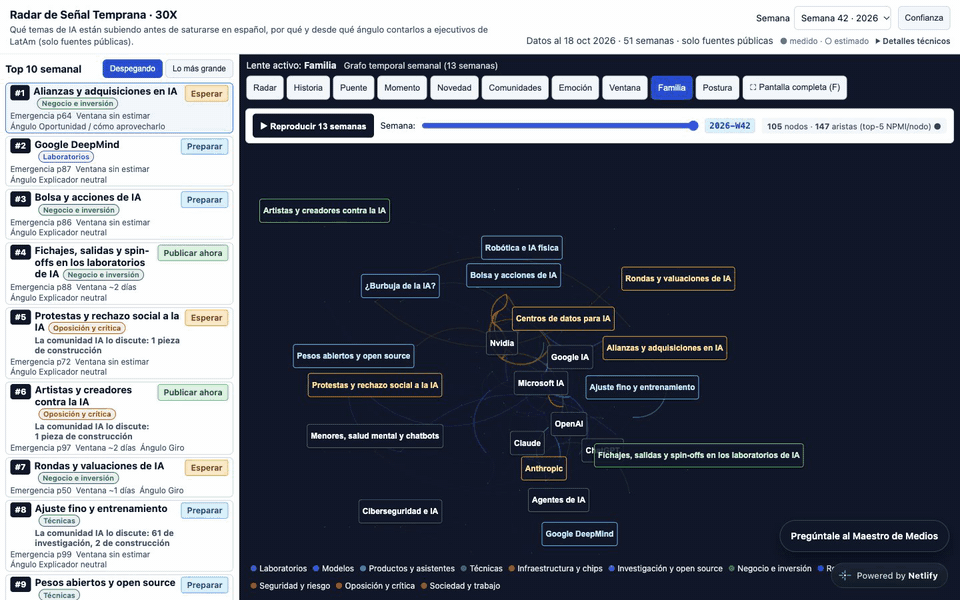 |

| Asking the Media Master: what is biggest this week | Rising vs. biggest: the two rails |
|---|---|
| 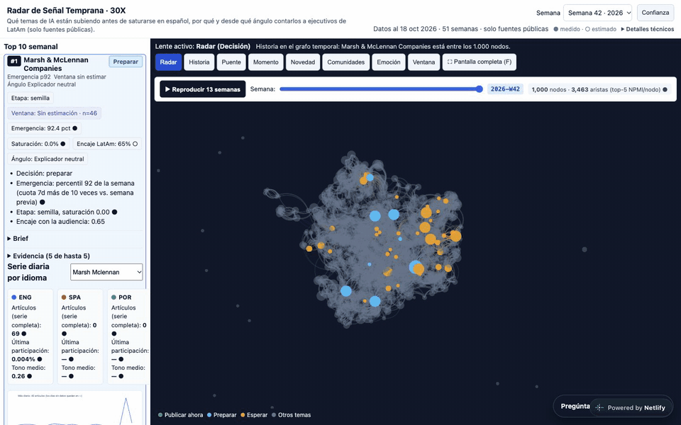 | 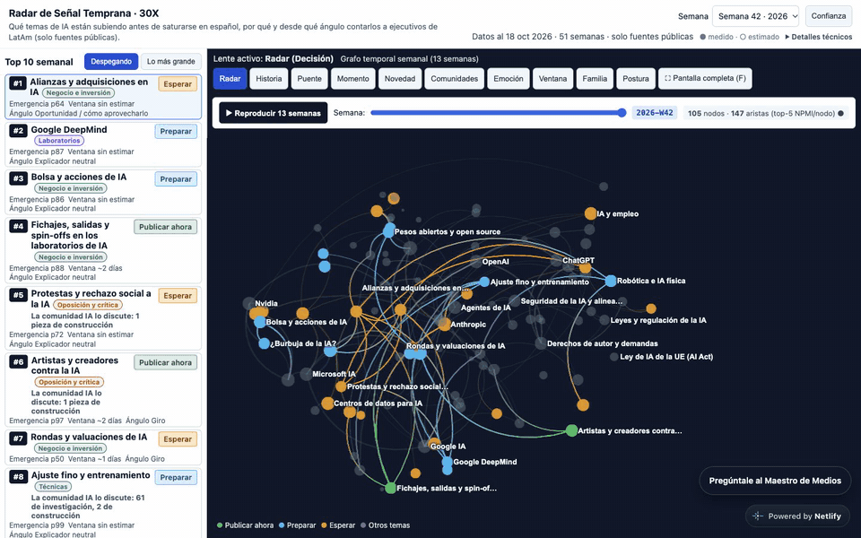 |

| The one-screen workspace | A topic's card: decision, signals, community line |
|---|---|
| 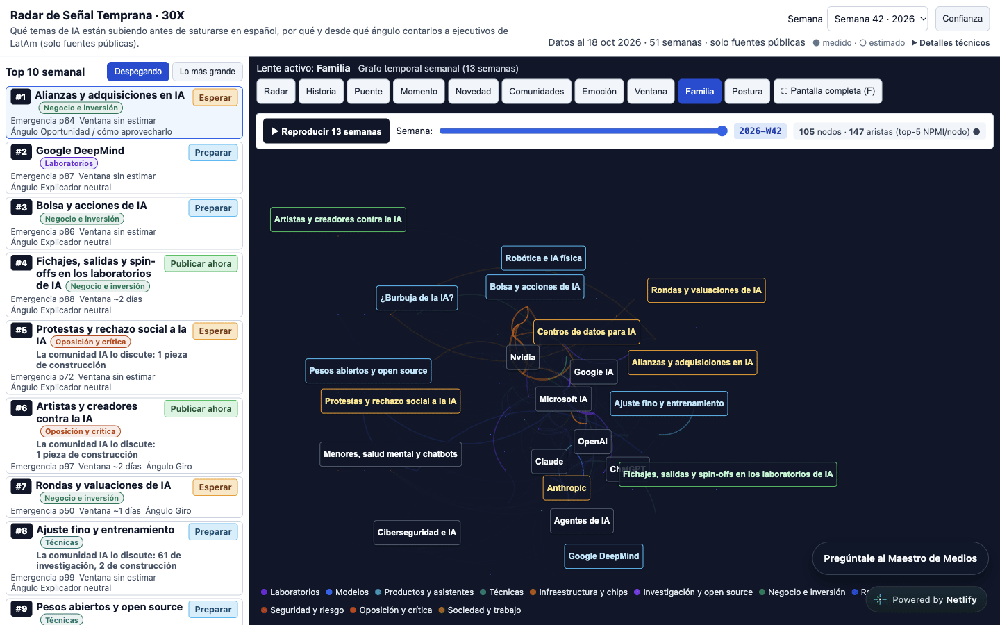 | 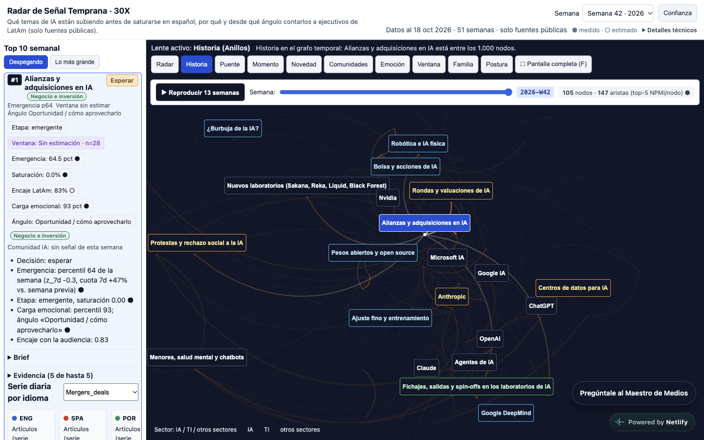 |

| How far to trust the radar | The AI graph in full screen |
|---|---|
| 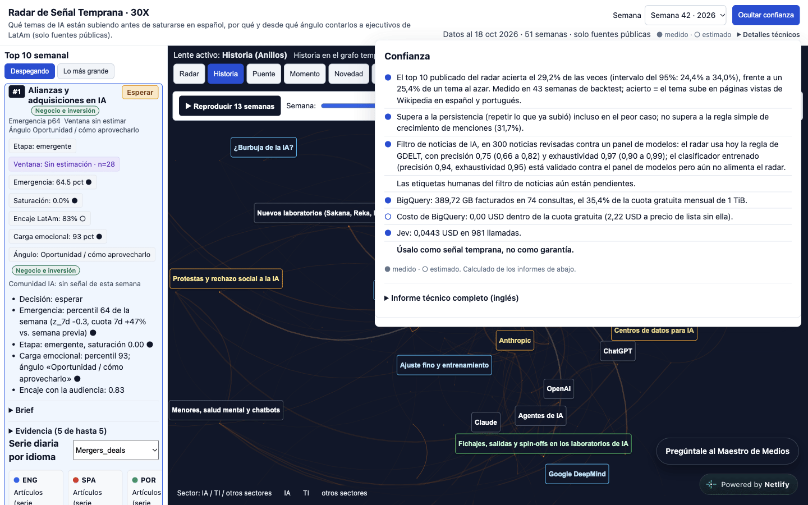 | 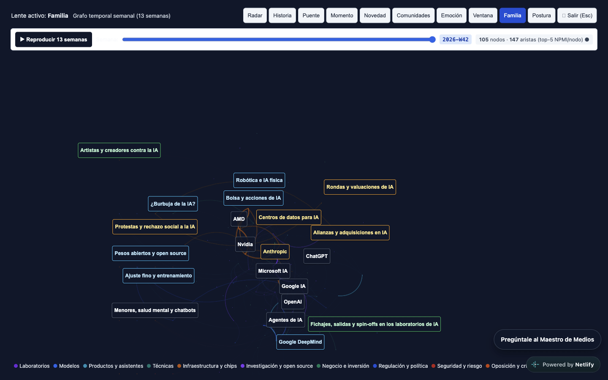 |

## Status

<sub>Updated 2026-10-18 10:40 UTC-5 for v0.3.0. Every number is measured unless marked otherwise.</sub>

| Part | State | Evidence |
|---|---|---|
| GDELT loop (WS1) | Done for 2025-11 → 2026-10-18 | 4.03M AI/IT/domain articles segmented; 389.7 GB billed over 74 BigQuery jobs ([ledger](reports/bq_ledger.csv)), inside the 1 TB free tier |
| Graph metrics, 1-hop ring (WS3) | Done, 51 weeks | 473,275 node-weeks; 4,773,204 ring rows, no persons |
| Link-prediction baselines (WS7) | Done | EdgeBank MRR 0.0050 on new edges, persistence 0.0123 on all ([report](reports/tgnn.md)) |
| AI lexicon (v0.3) | Done | 110 curated AI topics in 11 families, multilingual patterns, GDELT org aliases for AI-native companies, a stance per topic (promoter, critic or neutral); no persons. All 110 match articles; 101 reach the 20-article floor in some week ([contract](contracts/ai_lexicon.yaml)) |
| Scores, window, decision (WS4) | Done on the lexicon | 3,379 topic-weeks. Top 10: 10/10 AI topics in W41 and W42, each with ≥ 21 articles. W42: alliances and acquisitions, Google DeepMind, AI stocks, talent moves, protests, artists vs AI, funding, fine-tuning, open weights, robotics |
| Leaders by volume | Done | W42: Nvidia 4,718 · OpenAI 2,691 · Microsoft 2,153 · Google 2,116 · Anthropic 1,938 · agents 996 · ChatGPT 929 articles |
| Backtest (WS4) | Both runs reported, with their limits | **AI lexicon run** ([report](reports/backtest_ai.md)), 43 weeks:<br>• Secondary label (es+pt GDELT growth): 25.6% (22.3-28.8) vs base 25.4%. It beats persistence (+13.3 points) but not raw-count growth (−1.6, −5.6 to 2.3).<br>• Primary label (es+pt pageviews): 27.7% (24.0-31.2) vs base 26.5%. Coverage is 89.5%, below the 90% rule: only 29 of 110 entries have es/pt Wikipedia pages.<br>**The AI ranking is relevant, but on these labels it is not yet better than chance.**<br>**v0.2 run** ([report](reports/backtest.md)): 29.2% (24.4-34.0) vs base 25.4% on the primary label |
| Wikipedia resolution and pageviews (WS6) | Done | 11,060 topics resolved (1,916 exact); 368,394 es+pt daily pageview rows; 0 failed requests and 0 rate-limit errors at one request per 6.5 s |
| Article classifier cascade (WS2b) | Done; the 300-row human check is pending | The teacher panel (Qwen3-235B, DeepSeek-V4-Pro) agrees 96.8% on "is AI".<br>The local student scores F1 0.964 against the panel. On 300 sheet rows, precision is 0.94 for the student and 0.75 for the GDELT rule.<br>Jev was called only for doubtful cases: $0.044 over 981 calls ([report](reports/label_quality.md)) |
| Evidence articles (WS1d, WS1e) | Done, deduplicated | Up to 5 articles per top topic-week, one per outlet and one per story (site suffixes stripped).<br>1,191 articles over 240 topic-weeks, 0 duplicates; before the fixes, 463 of 1,200 slots were repeat copies.<br>Titles and URLs appear only on the deployed site, never in git |
| AI community sensor | Done; unvalidated | 3,636 items from 25 public sources over 13 weeks (measured): HF papers and model releases, AI Engineer, DataTalksClub live streams, Vanishing Gradients, Gradient Dissent, CoreWeave, W&B, YC (RFS and videos), The Batch, practitioner newsletters, safety and critic organisations. Kept out of the backtest |
| Spanish briefs | Done on the AI top 10 | 20 briefs (W41-W42); 20/20 pass the Auditor. A check catches coverage claims that contradict the brief's own es/pt count: 8 of 20 did before it, 0 after |
| Agents | Done, traced and evaluated | 8 agents on Qwen3-30B, plus the leaders and community tools. Release eval v3 (28 questions × 3, AI lexicon): **grounding 0.964 (0.93-1.00)**, decisions and routing 1.000, usefulness (a judge that sees the data) 0.619 (0.60-0.64). Community questions are still weak: 0.50 ([eval](#evaluation-loop)) |
| Graph views | Done, on the AI graph | cosmos.gl temporal graph of the lexicon topics, coloured by family, and sigma.js story view. Nine question-driven lenses, including **Postura** (promoters vs critics). A graph image when the browser has no WebGL |
| UI | Done, after a design review | A rail toggle **Despegando / Lo más grande**, family chips, a community line when there is a signal, graph, collapsible chat dock, a trust panel with a calibrated Spanish summary. Spanish throughout; measured (●) vs *estimated* (○) marks |
| Deploy | Live in AI mode (Cloud Run revision 00011, min-instances 1 for the demo) | One command redeploys everything (3 min 24 s); live check 8/8 with a real chat turn (10.3 s) |

## Architecture

### System overview

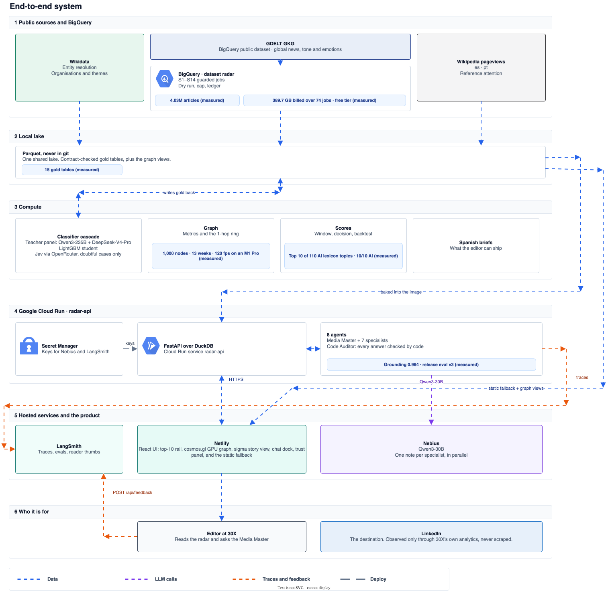

Animated lines show data in blue, LLM calls in purple, and traces in orange. The editable sources are in
[`docs/diagrams/`](docs/diagrams/).

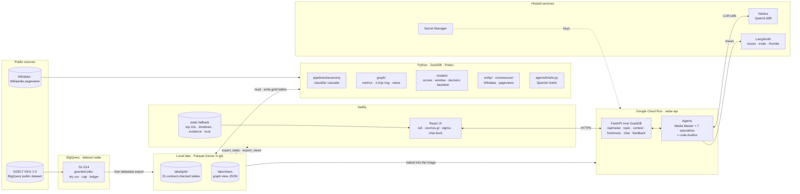

Every interface between modules goes through [`contracts/`](contracts/). That covers:
- a JSON Schema for every table and every agent message;
- the taxonomy (`taxonomy.yaml`);
- the agent roster (`agents.yaml`);
- the API (`api.yaml`).

A `RADAR_PROFILE` switch serves either the full lake or a small real slice committed in `fixtures/dev/`: 8 weeks,
a column allow-list, and no URLs, titles or person names.

### How the data flows

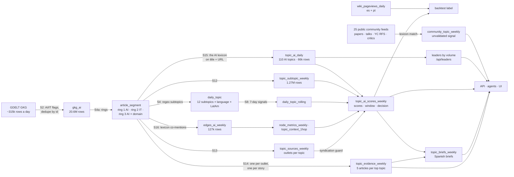

- **Three rings.** Ring 1 is core AI news, ring 2 is IT news without AI, and ring 3 is AI crossing a domain: climate
  and energy, business, labour, health, education, elections and misinformation, law, security. Only ring 1 is
  ranked; rings 2 and 3 give context. The rules are in [`contracts/taxonomy.yaml`](contracts/taxonomy.yaml).
- **What is ranked (v0.3).** Entries of the AI lexicon with at least 20 AI articles in a week, matched on titles and
  URLs in every language, plus GDELT org aliases for AI-native companies. v0.2 ranked GDELT's extracted
  organisations co-mentioned in AI articles. GDELT does not extract most AI-native entities (no `org:openai` in
  2026-W42, measured), so that top 10 filled with banks and retailers. The v0.2 run is kept for the backtest
  comparison (`RADAR_SOURCE=gdelt`).
- **Missing days stay missing.** They are `NULL`, never zero.
- **BigQuery spend is guarded.** Every job is dry-run first, aborts above 1.5× the last bill of the same script, and
  is logged in [`reports/bq_ledger.csv`](reports/bq_ledger.csv).

### Agent orchestration

**Code decides and computes; the LLM explains.** Code routes each question to a few specialists, each with a fixed
data plan. Code also writes the facts the answer must not change, and an Auditor checks the draft before it reaches
the reader.

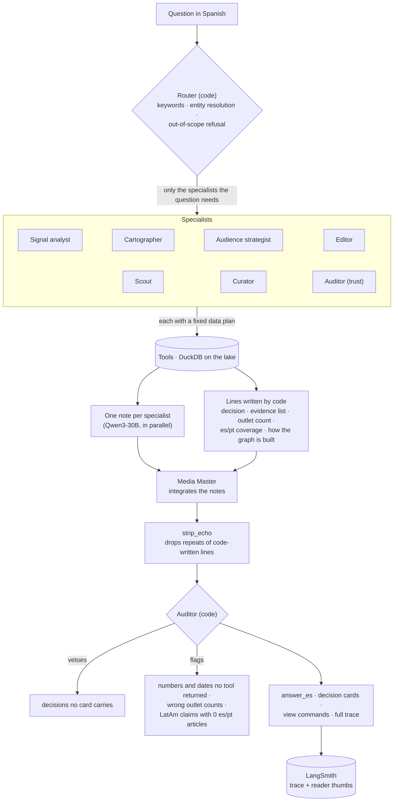

| Agent | Owns | Tools the runtime calls |
|---|---|---|
| Media Master | the conversation; integrates the team's notes into one recommendation | delegates only |
| Signal analyst | what is rising, the top 10 and its decisions | `get_top10`, `get_leaders`, `get_topic_scores`, `list_subtopic_trends`, `get_topic_series`, `get_language_coverage`, `get_topic_sources`, `get_topic_evidence`, `get_community_signal` |
| Cartographer | why a topic connects to others; drives the views | `get_context_1hop`, `get_graph_facts`, `update_view` |
| Audience strategist | fit for LatAm executives, the framing angle | `get_topic_series`, `get_topic_scores` |
| Editor | what content to prepare | `get_topic_brief`, `get_topic_evidence`, `get_topic_series`, `get_context_1hop` |
| Scout | data freshness and cost | `get_freshness`, `get_cost_ledger` |
| Curator | what counts as AI news; filter quality | `get_segment_mix`, `get_filter_quality` |
| Auditor | how far to trust the radar; checks every answer | `get_backtest`, `get_filter_quality`, `get_cost_ledger` (only for cost questions) |

### One question, end to end

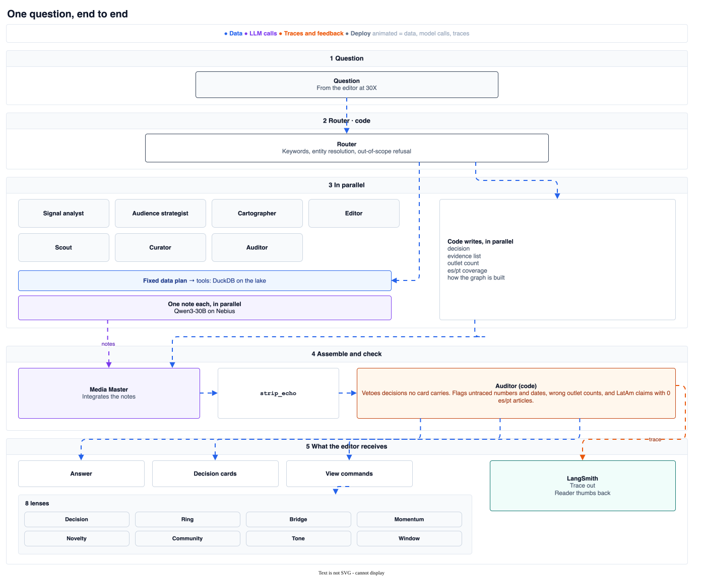

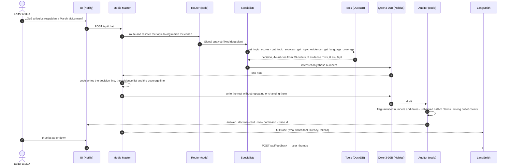

Measured on the live service, a chat turn takes 6.5-12.5 s end to end.

### The graph views

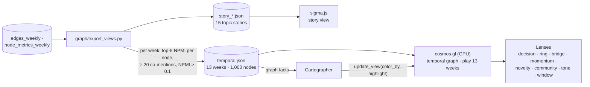

Each node and edge carries properties computed per week:
- co-mentions and NPMI;
- the edge state (new, growing ≥ 1.5×, fading ≤ 0.5×, persisting), measured against the unpruned previous week;
- betweenness and importance;
- sector crossing, momentum and community.

A lens re-lays out and recolours the graph by one property. The Cartographer picks a lens from the question ("¿qué
temas hacen de puente?" opens the bridge lens) and highlights the topics it talks about.

### Build, evaluate, ship

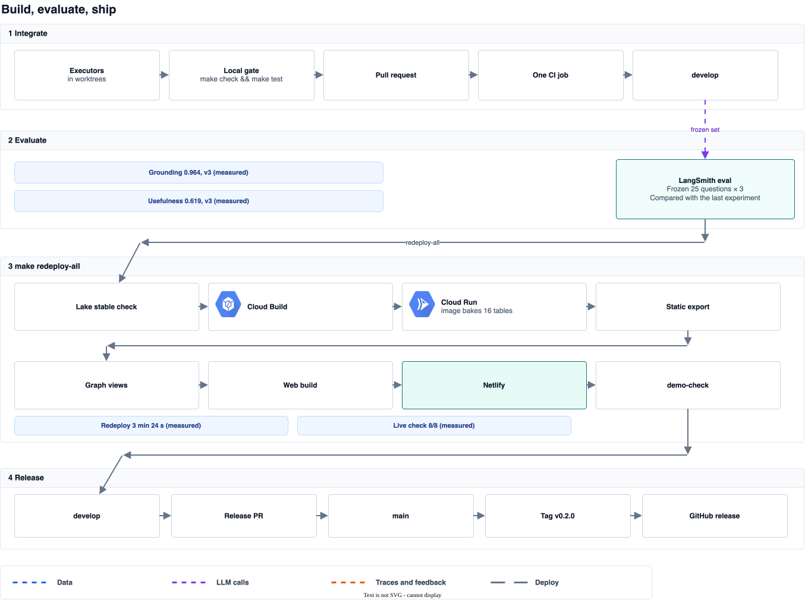

### Evaluation loop

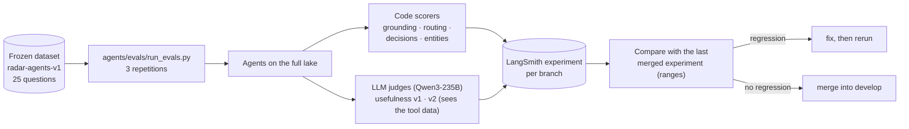

Every agent PR reports its experiment against the previous one, with the min-max of the three repetition means:

| Experiment | grounding | usefulness_v2 | tokens/turn |
|---|---|---|---|
| Before the quality work | - | 0.383 | - |
| After the quality work | 0.973 (0.92-1.00) | 0.567 (0.51-0.60) | 5,824 |
| Graph facts written by code | 0.933 (0.88-0.96) | 0.647 (0.61-0.67) | 6,205 |
| Release v0.2.0 (set v1, GDELT orgs) | 1.000 (1.00-1.00) | 0.663 (0.63-0.70) | 6,355 |
| **Release v0.3.0** (set v3: 28 questions on the AI lexicon, not comparable with v1) | **0.964 (0.93-1.00)** | **0.619 (0.60-0.64)** | 6,359 |

### Deployment

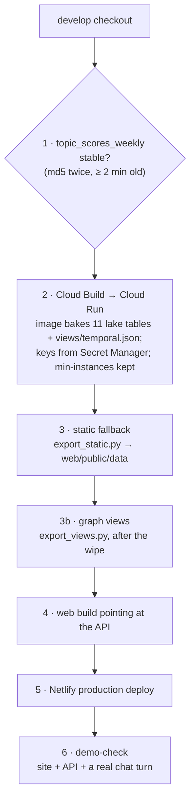

`make redeploy-all` prints every step as a dry run; `ARGS=--run` deploys. The image never contains `.env`, person
nodes, article titles or URLs, and the stage step refuses a view file with person nodes.

### The article classifier cascade

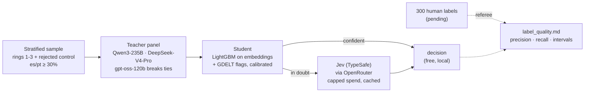

Jev is used only at decision time, for doubtful cases. Its answers are logged and never used as training labels,
because its terms do not say that training on them is allowed.

## How the team works

One orchestrator (a Claude Code session) owns the contracts. It writes a brief per branch, reviews every commit, and
merges into `develop`. Executors work in their own git worktree, only on the files their brief lists.

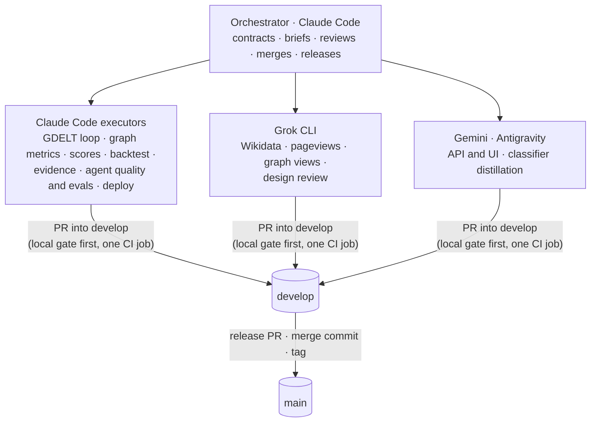

- Every branch lives in its own worktree under `../radar-worktrees/` and shares one git-ignored lake.
- Each brief states the goal, inputs, outputs, the files the executor may touch, acceptance, approvals and deadlines.
  Blocked executors write `BLOCKED: <reason>` in `status/WS<N>.md` and stop.
- The orchestrator checks UI work in the browser at two widths before merging, and sends findings back as numbered
  items in the brief.
- CI is one job, on pull requests only. The same hooks run locally first, because Actions minutes are scarce.

## Repository

| Path | What it is |
|---|---|
| [`contracts/`](contracts/), [`mocks/`](mocks/), [`fixtures/dev/`](fixtures/dev/) | Schemas, taxonomy, agent roster, API; mocks copied from real output; the real dev slice |
| [`agents/`](agents/) | Multi-agent runtime, tools, the Auditor, Spanish briefs, LangSmith evals |
| [`bq_sql/`](bq_sql/), [`pipelines/ingest/`](pipelines/ingest/) | BigQuery scripts S1-S14, the guarded runner, the lake export |
| [`pipelines/taxonomy/`](pipelines/taxonomy/) | Rings, subtopics, the classifier cascade |
| [`graph/`](graph/) | Node metrics, 1-hop ring, the temporal and story view exports |
| [`models/`](models/), [`models/tgnn/`](models/tgnn/) | Scores, window, decision, backtest; link-prediction baselines |
| [`entity/`](entity/), [`crosssource/`](crosssource/) | Wikidata resolution, Wikipedia pageviews |
| [`api/`](api/), [`web/`](web/) | FastAPI over DuckDB; React UI with cosmos.gl, sigma.js and the chat dock |
| [`deploy/`](deploy/), [`scripts/`](scripts/) | Cloud Run image staging, the static export, the ordered redeploy, demo check |
| [`reports/`](reports/) | Evidence: BigQuery ledger, baselines, backtest, label quality |
| [`docs/`](docs/) | Plan, designs, development procedures, submission kit, executor briefs, media |
| [`status/`](status/) | One status file per workstream |
| [`src/radar/`](src/radar/) | Lake paths, profiles, contract validation |

## Quick start

```bash
make setup                                   # uv env, git hooks, .env from the template
make test                                    # what CI runs (dev slice, no network)
make ask Q="¿Qué tema de IA sube esta semana y por qué?"   # needs NEBIUS_API_KEY
make api-dev                                 # API on the dev slice
make web-dev                                 # UI
RADAR_PROFILE=full make api-dev              # the full lake, once exported
make redeploy-all                            # dry run of the full redeploy (ARGS=--run deploys)
make demo-check                              # check the live site and API
```

## Engineering practices

- [Conventional Commits](https://www.conventionalcommits.org/en/v1.0.0/) enforced at commit time; PR titles checked
  in CI.
- The same pinned pre-commit hooks run locally and in CI: Ruff, file hygiene, actionlint, detect-secrets, the
  lockfile and the contracts-versus-mocks check.
- Work branches come from `develop`, and `develop` → `main` is the release. [SemVer](https://semver.org/) 0.x and a
  [changelog](CHANGELOG.md).
- Contracts first: every table and agent message is a JSON Schema, and the mocks are copied from real output.
- Every number is marked measured or estimate. When the data shows no signal, the report says so.

Rules for contributors and coding agents: [AGENTS.md](AGENTS.md). Procedures: [docs/development/](docs/development/).

## Data and attribution

News signals come from the [GDELT Project](https://www.gdeltproject.org/) via its public BigQuery dataset. Reference
attention comes from Wikidata and the Wikimedia pageviews API. Headlines, URLs and person names never enter git.

## License

[MIT](LICENSE).
