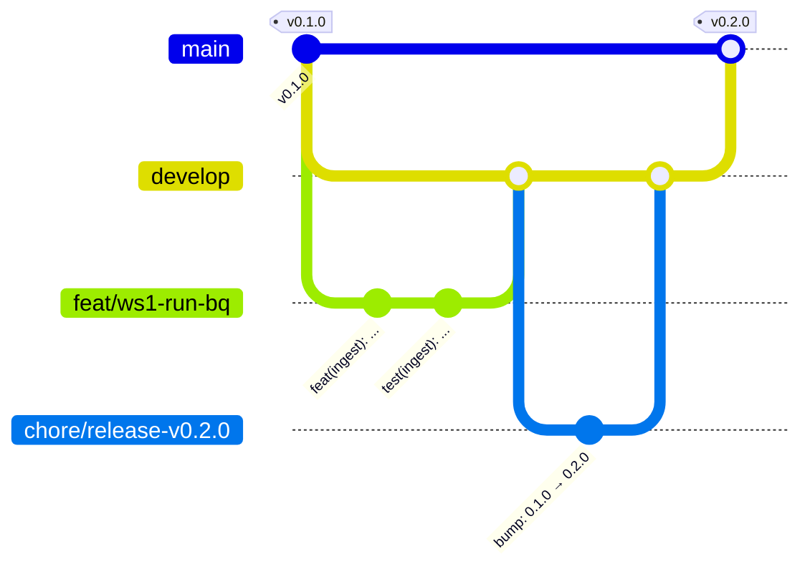

# Git workflow

The rules are in [`AGENTS.md`](../../AGENTS.md); this page is the step-by-step version.

## Branches at a glance



| Branch | Starts from | Merges into | Lifetime |
|---|---|---|---|
| `main` | — | — | permanent, demo |
| `develop` | `main` | — | permanent, integration |
| `<type>/ws<N>-<desc>` | `develop` | `develop` | a few hours |
| `chore/release-vX.Y.Z` | `develop` | `develop` | minutes (the version bump) |

`develop` → `main` is the only way into `main`, and it is the release.

## Start a piece of work

```bash
cd radar                                       # the main checkout, always on main
git pull --ff-only                             # keep main current; never commit here
make worktree BRANCH=feat/ws1-run-bq           # worktree from origin/develop, lake linked
cd ../radar-worktrees/feat-ws1-run-bq
uv sync --extra bq                             # your workstream's extra
```

Worktree directory names replace the `/` of the branch with `-`. Hooks live in the shared
`.git`, so installing them once (`make setup` in the main checkout) covers every worktree.

## While working

- Commit small, self-contained changes; every commit passes the hooks on its own.
- Keep the branch current with `develop`: `git fetch origin && git merge origin/develop`
  (merge, not rebase, once the branch has been pushed).
- Land work at every sync point; a branch older than one sync is split.

## Publish and merge

1. Run the local gate: `make check && make test`. CI minutes are scarce, so CI must not be where
   failures are found.
2. Ask the maintainer to approve the push, then `git push -u origin <branch>` (a push runs no CI).
3. `gh pr create --base develop --draft` with a Conventional Commit title and the PR template.
4. When the brief's acceptance passes locally, `gh pr ready <n>` (this starts the one CI run).
   Batch any fixes into a single push.
5. The orchestrator merges (`gh pr merge --squash` or `--merge`, never `--delete-branch`).
6. Remove the worktree, keep the branch: `git worktree remove ../radar-worktrees/<dir>`.

## Stacked work

If a branch needs another unmerged branch, base it on that branch, open its PR against it,
and retarget the PR to `develop` (`gh pr edit <n> --base develop`) **before** merging the
base: CI only runs on PRs into `develop` or `main`.

## Recovering

- Committed on the wrong branch: `git branch <new>` at that commit, then reset the wrong
  branch only if it was never pushed; otherwise revert by PR.
- A hook failed and modified files: inspect the change, re-stage, commit again. If
  `detect-secrets` rewrote `.secrets.baseline` because line numbers moved, re-stage it.
- `pre-commit` refuses to run because `.pre-commit-config.yaml` has unstaged edits: stage it.
